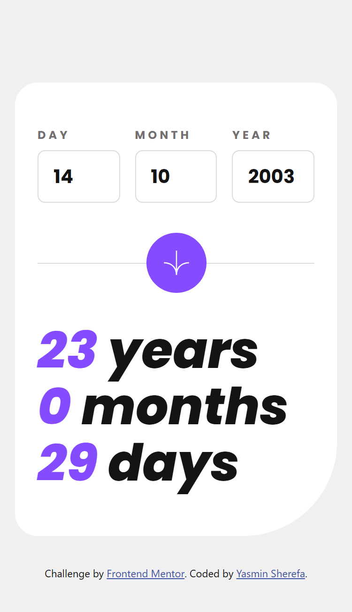
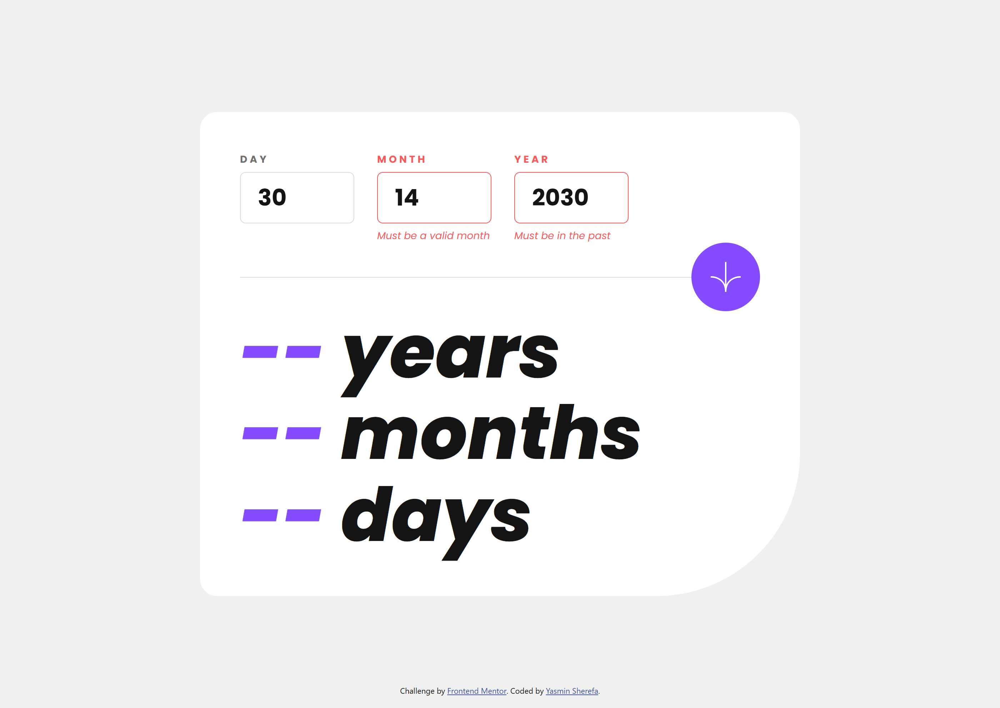

# Age Calculator App

A responsive age calculator built for the [Frontend Mentor Age Calculator challenge](https://www.frontendmentor.io/challenges/age-calculator-app-dF9DFFpj-Q). Enter a date of birth and see your exact age in years, months and days, with form validation and an animated count-up.


## Screenshots

### Mobile



### Validation states

| Empty form | Invalid month and future year |
| --- | --- |
|  |  |

## Features

- Exact age in **years, months and days** (handles leap years and short months correctly)
- Validation with clear messages:
  - empty fields: *This field is required*
  - day outside 1-31: *Must be a valid day*
  - month outside 1-12: *Must be a valid month*
  - year in the future: *Must be in the past*
  - impossible dates such as `31/04/1991` or `29/02/2023`: *Must be a valid date*
- Numbers **count up** to the final value (disabled automatically for users who prefer reduced motion)
- Fully **responsive** layout for mobile and desktop
- Hover and focus states on every interactive element
- Keyboard friendly: submit with Enter, focus jumps to the first invalid field
- Accessible: real `<label>`s, `aria-invalid`, `aria-describedby` for errors, and a screen-reader summary announced through `aria-live`

## Built with

- Semantic **HTML5**
- **Tailwind CSS v4** (browser build, design tokens defined with `@theme`)
- Vanilla **JavaScript** (no libraries)
- Self-hosted **Poppins** font

## How the age is calculated

Subtracting dates field by field breaks on edge cases (for example, born on 31 January and checking on 1 March). Instead:

1. Count the whole **months** between the two dates, and subtract one if the birthday day hasn't been reached yet this month.
2. Turn those months into **years + months**.
3. Count the leftover **days** from the "month anniversary" to today. If the anniversary day doesn't exist (like the 31st in April), it falls on the last day of that month.

The date logic lives in pure functions (`validateDate`, `calculateAge`) that don't touch the DOM, so they are easy to test.

## Project structure

```
age-calculator/
├── index.html
├── style.css
├── script.js
├── README.md
├── assets/
│   ├── fonts/
│   └── images/
└── screenshots/
```

## Run it locally

No install needed. Open `index.html` in the browser, or use the VS Code **Live Server** extension. An internet connection is needed because Tailwind loads from a CDN.

## What I learned

- Working with dates in JavaScript: leap years, month lengths and why `Date` arithmetic needs care
- Separating pure logic from DOM code
- Building accessible form validation (`aria-invalid`, `aria-describedby`, live regions)
- Using Tailwind variants (`md:`, `group-data-[...]`, `aria-[...]`) to style states without writing custom CSS
- Animating numbers with `requestAnimationFrame`

## Author

**Yasmin Sherefa** - [GitHub](https://github.com/yasmin3802)